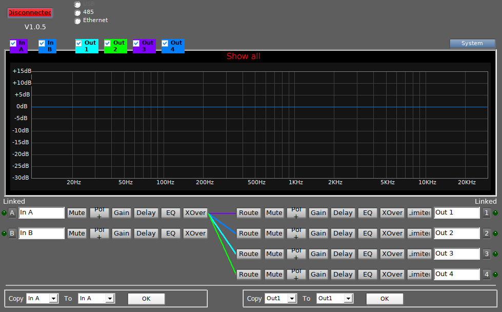
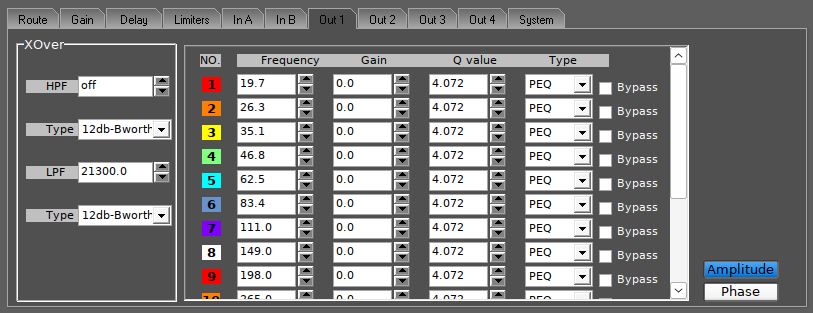
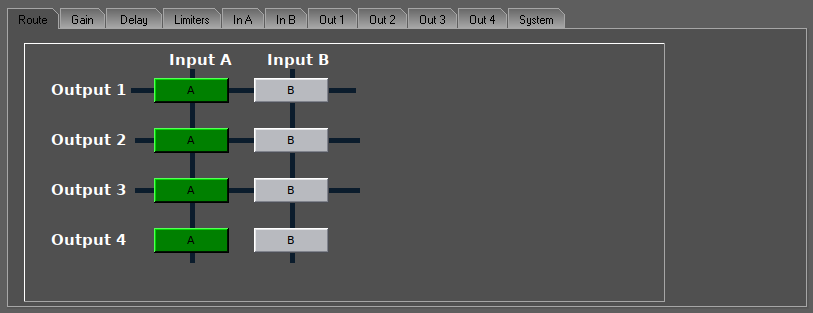
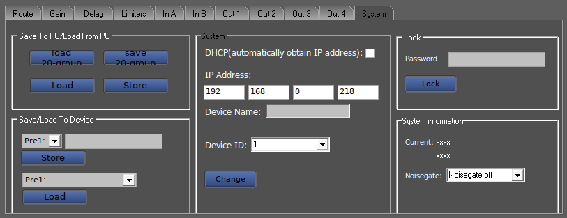
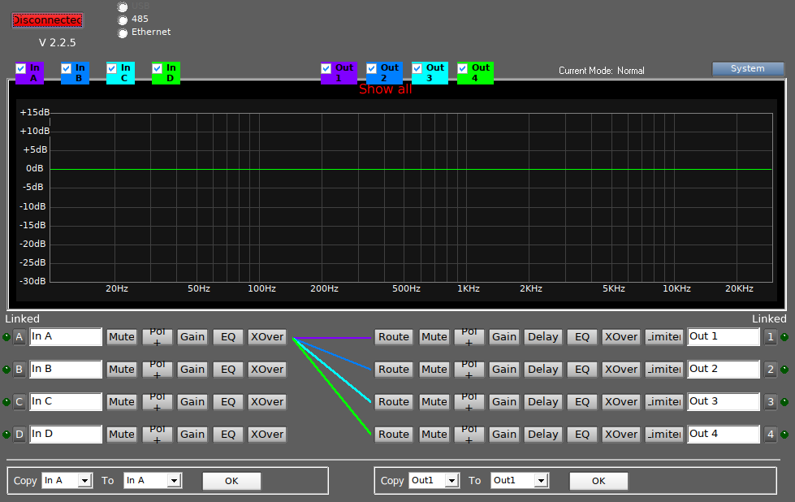

# Reverse engineering notes

Source binary: `win_binaries/plate amplifier with APF F2311_V1.0.5_20180525.exe`
(despite the filename, this is the **active top / plate-amp DSP** control app —
the standalone subwoofer-amp app will be added later).

## What the binary is

- Win32 PE, built with an old Delphi (VCL). Uses the **JVCL** `JvHidController`
  component and the Win32 `HidD_*` / `HidP_*` API directly — so the PC talks
  to the DSP as a **USB HID device**, not a virtual COM port. The HID product
  string is literally `DSPSERIALSUSB08 (Serial=0000007)` (see strings dump).
- Also references `cbb_comport` / `cbb_comport2` (COM port pickers) and a
  `cbb_deviceid` combo box with **255 entries** ("1".."255"). Working theory:
  units can be daisy-chained on an RS-485 bus, and the HID-attached unit acts
  as a USB↔RS485 bridge, with a per-unit device/address ID distinguishing
  which chained unit a command targets. This matters a lot for us: our
  `Transport`/protocol layer should treat "device address" as a routing field
  independent of the physical USB connection, so one USB link can address
  several physically-chained DSPs — exactly the "manage several devices from
  one interface" requirement.
- UI skin libraries (Raize/TurboPower `RzXxx` components, "BlueGlass"/"DeepBlue"
  skins) are irrelevant to the protocol — purely cosmetic VCL third-party
  components, ignore them when reading the dumped forms.

## Method used so far: static extraction of the compiled DFM forms

The actual wire protocol (byte layout of the USB HID reports) is **not**
visible in strings or resources — that requires dynamic capture (see
"What's still needed" below). But a surprising amount of ground-truth detail
*is* recoverable statically, because Delphi compiles each form's designed
properties into a binary resource (`RT_RCDATA`, signature `TPF0`) baked into
the `.rsrc` section, and that resource records every control's design-time
properties **by name** — including combo box item lists, slider min/max,
default values, edit max-lengths, tab order, etc. That's effectively the
original developer's UI spec, minus the Pascal event-handler code.

Tools written for this (kept in `re/`):

- `re/dfm_parse.py` — a from-scratch parser for the binary `TPF0` DFM format.
  There is no official spec; this was reconstructed from a community write-up
  of the general grammar (is4code.blogspot.com, March 2022) plus the classic
  Delphi `TValueType` tag enum, then **debugged against the actual file**
  until every resource in this exe parses with **zero leftover bytes**
  (checked for all 11 `TPF0` resources, including the two big forms at
  848,460 and 321,168 bytes) — that's a strong correctness signal, not a
  guess. Two corrections were needed versus the naive spec:
  - Tag `0x0E` (`vaCollection`) items are prefixed by a marker byte: `0x00`
    ends the collection, `0x01` introduces one item (itself a plain
    name/value property list).
  - Tag `0x12` (`vaWString`) stores its length as a **character count**, not
    a byte count — read `len*2` bytes and decode as UTF-16LE.
  Run it as `python3 re/dfm_parse.py <file.bin> [--json]`.
- `re/extracted_f2311/*.bin` — every `RT_RCDATA` resource extracted from the exe via
  `pefile` (see inline script used; redo with `pefile` if resources need
  re-extracting). `TFORM1` = the connect/device-list/login shell window.
  `TFORM2` = the actual per-device DSP control panel (gain/delay/crossover/
  EQ/limiter/system tabs) — this is the one that matters for the protocol.

See `docs/DATA_MODEL.md` for what this extraction revealed about the actual
parameter set, ranges, and defaults.

`win_binaries/D10Q DSP amplifier software_V2.2.5_APF_20180508.exe` (the
subwoofer amp app) is the same Delphi/JVCL/HID codebase -- same
`DSPSERIALSUSB08` HID product string (different serial suffix), same form
shapes -- and parses cleanly with the same tool (`re/extracted_d10q/`). This
is good evidence the two device families share one wire protocol with
different channel/band counts, not two unrelated protocols. See
`docs/DATA_MODEL.md` for the (small) set of confirmed differences.

## What's still needed: the actual wire bytes

Static analysis cannot show what bytes go over the HID `SetFeature`/
`GetFeature`/write calls when, say, you drag the gain slider. For that we
need **dynamic capture**, and neither is available on this machine (`adula`)
right now:

- No `wine` installed, and this session's `sudo` has no usable password, so
  `apt install wine` (or `radare2`/`ghidra` for a real disassembly) needs to
  be run by the user directly (`!sudo apt install wine ghidra` etc.), not by
  Claude.
- No device plugged in (`lsusb` shows only the root hubs + a Bluetooth
  adapter) — even with Wine, there's nothing to talk to without the real
  active-top hardware attached, or a way to fake HID enumeration convincingly
  enough to fool `HidD_GetAttributes`/`HidD_GetFeature` calls.

Recommended next steps, in order of effort:

1. **Capture on real hardware, in whatever way is most convenient** — plug a
   top into a Windows machine (or this machine via Wine once installed) and
   sniff the USB traffic with Wireshark+usbmon (Linux) or USBPcap (Windows),
   while using the original app normally. This is the highest-confidence,
   lowest-effort path once hardware is accessible, and doesn't require
   understanding the Delphi binary at all.
2. Cross-check captured bytes against this document's data model (which
   field changed when you moved which slider) to reverse the framing.
3. Only if (1) isn't practical: static disassembly of the HID read/write call
   sites (Ghidra/radare2) to recover the packet-building code directly. Much
   slower; the strings/DFM work above already did most of the *useful* part
   of this (knowing the parameter set) without needing it.

Until real bytes are captured, `sanray-protocol`'s wire codec for the real
device is a stub (`codec::sanway_f2311`, marked `todo!()`), and the mock
device speaks a separate, explicitly-fake `codec::sanray_native` protocol so
the rest of the framework (transport abstraction, app logic, UI) can be built
and tested now, then pointed at the real codec once it's known.

## Update: both apps actually run now (Wine, via Docker)

This machine's Wine install is 64-bit only (`wine64`/`wine` packages), and
both exes are 32-bit (PE32/i386) — `apt install wine32` can't be used to fix
that here: it's blocked by a dependency conflict traced to `libzstd1` being
pinned at a custom Savoury1-PPA build (`1.5.5+dfsg-0ubuntu1~18.04.sav1`,
see `~/Changelog.md` 2026-09-01) with no i386 counterpart. Forcing apt
through that risks breaking whatever that pin was protecting (LibreOffice/
ffmpeg4/old Python stdlibs per the Changelog) — not worth it for this.

Instead: `docker pull scottyhardy/docker-wine:stable`, run it with
`--ipc=host` (required — without it, Wine's X11 rendering fails with a
`BadValue`/`MIT-SHM` error, because the container's IPC namespace doesn't
match the host X server's) and `WINEARCH=win32`, mount the host's X11 socket
and `win_binaries/`, and both apps come up fully interactive on the host's
real display. `xdotool` (installed inside the container, not the host) +
`wmctrl` (host) was enough to click through both apps' dialogs
non-interactively and screenshot them (`docs/screenshots/`).

| Main window | EQ/XOver tab | Routing matrix |
| --- | --- | --- |
|  |  |  |

| System/network tab | D10Q amp (same dialog family) |
| --- | --- |
|  |  |

### What clicking through actually revealed

Both apps' **"Config" dialog** (opened via any channel's EQ/XOver button) has
tabs: `Route | Gain | Delay | Limiters | In A | In B | Out 1..4 | System`.
Everything in `docs/DATA_MODEL.md` was updated from this; highlights that
were *not* visible in the static DFM extraction:

- **A real input routing matrix** (`Route` tab): each output independently
  chooses which input(s) feed it (toggleable per input×output cell), not a
  fixed 1:1 in→out mapping. See `docs/screenshots/f2311_route.png`.
- **Connection type is USB, RS-485, *or* Ethernet** (radio buttons on the
  main window) — the `System` tab has a real IP config (DHCP checkbox,
  static IP, device name, device/chain ID) alongside the on-device/PC preset
  save-load. So the "RS-485 chaining behind one USB-HID link" theory from
  static analysis was only part of the picture — Ethernet is a first-class
  transport too, not just a fallback. See `docs/screenshots/f2311_system.png`.
- **Runtime defaults differ from the DFM's design-time placeholder text.**
  E.g. the limiter dropdowns' DFM-recorded `Text` was `-25dB`/`0.5ms`/`100ms`,
  but what the running app actually initializes to is **-6dB / 0.5ms /
  100ms**. The DFM's `Text` property was just whatever the first item
  happened to be at design time, not a reliable runtime default — trust the
  live app over the DFM for anything described as a "default" in
  `docs/DATA_MODEL.md` now that both are checkable.
- **PEQ bands' real default frequencies and Q**: band defaults are **not**
  `Q=1.0` as the DFM suggested (that was band 0's design-time placeholder) —
  the live app initializes all bands to **Q=4.072** and spreads center
  frequencies logarithmically (19.7, 26.3, 35.1, 46.8, 62.5, 83.4, 111.0,
  149.0, 198.0, 265.0 Hz for bands 1-10, ...). See
  `docs/screenshots/f2311_eq_xover.png`.
- **Delay can be entered in milliseconds, metres, or feet** (a unit toggle
  under the Delay tab) — a nice UX touch worth keeping regardless of wire
  protocol, since it's just a client-side conversion by the speed of sound.
- Confirmed the D10Q amp is the same UI/dialog family (`docs/screenshots/
  d10q_main.png`), just with inputs labeled A-D instead of "In A"/"In B" and
  4 outputs instead of the plate-amp's 4 — consistent with the shared-
  protocol-family hypothesis.

None of this reveals wire bytes (still needs a USB/network capture against
real hardware), but it meaningfully improves confidence in the parameter
model doc and surfaces a routing-matrix feature we hadn't planned for.

### Design direction: improve on this, don't clone it

Per explicit direction from the project owner: sanray should take the
*useful ideas* from this exploration (the routing matrix, multi-unit
addressing, metres/feet delay entry) rather than aim to reproduce this
exact dialog-per-tab-per-channel UI/UX. The parameter *model* (gain ranges,
filter math, limiter behavior) is what needs to match for the DSP to sound
right; the interface around it is explicitly open to being rethought and
improved — e.g. a single view across multiple devices at once was the
original ask, which this tabbed-single-device-Config-dialog design doesn't
support at all.
